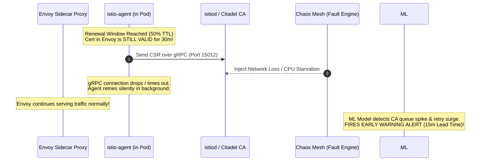
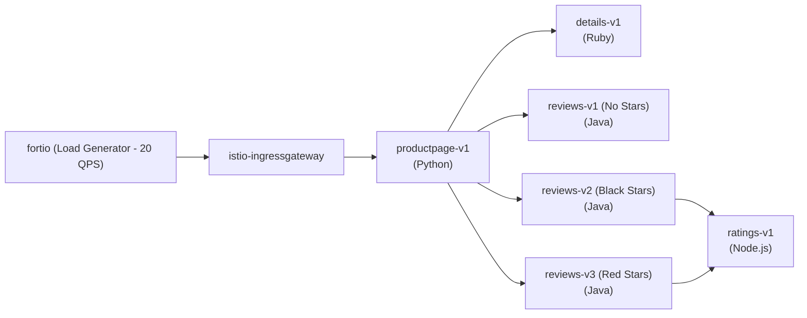
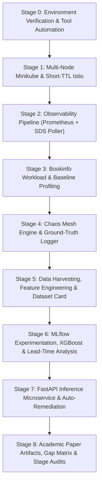

# Master Implementation Plan: Early Prediction of mTLS Certificate Rotation Failures in Istio Service Mesh

**Project Title**: Early Prediction of mTLS Certificate Rotation Failures in Istio Service Mesh Using Machine Learning  
**Core Domain**: Cloud Systems & Microservice Security (with Machine Learning as an Applied Tool)  
**Primary Platform**: Minikube (Multi-Node), Istio Service Mesh, Chaos Mesh, Prometheus, MLflow, FastAPI  

---

## 1. Executive Summary & Research Framing

### 1.1 The Problem & Academic Motivation
Mutual TLS (mTLS) is the industry standard for cryptographic identity and zero-trust service-to-service communication in modern cloud-native service meshes like Istio. In production environments, certificates are short-lived (e.g., 24 hours) and automatically renewed at mid-lifetime (50% TTL). 

However, real-world Kubernetes incidents reveal that **silent rotation failures** frequently occur due to:
- Control-plane CPU/memory exhaustion (`istiod`).
- gRPC transport degradation (packet loss, latency spikes on port 15012).
- Intermittent network partitions and CNI glitches.
- Identity validation stalls (e.g., ServiceAccount deletion, token expiry).

Currently, detection in production is **entirely reactive**: operators only discover failures after the certificate has expired, resulting in sudden TLS handshake rejections, HTTP `503 Service Unavailable (UF/URX)` cascades, and widespread service outages.

### 1.2 The Research Novelty Claim
- **The Gap**: Existing literature either focuses on general microservice failure/anomaly prediction (e.g., UPTEC 2021, MicroFP 2021) or handles SSL/TLS vulnerabilities reactively. **No existing work applies Machine Learning to forecast mTLS certificate rotation failures before they occur in a service mesh.**
- **Prediction as a Defensible Contribution**: Developing an early-warning signal that provides a **10–15 minute lead time** prior to certificate expiration allows operators or automated controllers to remediate issues before traffic is impacted.
- **Methodological Contribution (Dataset Generation)**: Because no public telemetry dataset exists for mTLS rotation failures, generating a realistic, reproducible, and labeled dataset via controlled Chaos Mesh injection is an explicit contribution.

---

## 2. Foundational Architecture & Design Rationale

### 2.1 Why We Need Network & Control-Plane Chaos (Not Just Cert Expiry)
A common question in evaluating this research is: *"Why not simply alert when `now >= notAfter - 5 minutes`?"*

1. **Passive Expiration Does Not Justify Machine Learning**: If certificates expired naturally on a fixed timer without underlying cluster degradation, a two-line cron script or static Prometheus alert would suffice with 100% precision.
2. **The Hidden Multi-Hop Rotation Pipeline**: In Istio, workload certificates do not expire naturally; they are designed to rotate seamlessly in the background at 50% TTL:
   $$\text{Workload Pod (istio-agent)} \xrightarrow[\text{gRPC (Port 15012)}]{\text{CSR + K8s SA Token}} \text{istiod (Citadel CA)} \xrightarrow[\text{gRPC}]{\text{Signed X.509 Cert}} \text{Envoy (via SDS)}$$
3. **Subtle Pre-Failure Telemetry**: When network packet loss (port 15012) or `istiod` CPU starvation occurs, **the existing certificate in Envoy remains 100% valid and continues serving traffic**. However, subtle anomalies emerge in control-plane metrics:
   - `citadel_server_csr_count` vs. `citadel_server_success_cert_issuance_count` diverge (CSR success ratio drops).
   - Sidecar gRPC connection retry counters surge.
   - CA signing queue latency grows.
   The ML model learns these early degradation signatures to predict failure **before** the valid certificate expires.



---

### 2.2 The Target Microservices Application (Istio Bookinfo)
To evaluate realistic mesh dynamics, we deploy the standard polyglot **Istio Bookinfo** application, consisting of **4 microservices across 6 pod deployments**:



1. **`productpage` (Python)**: Frontend web tier coordinating calls to `details` and `reviews`.
2. **`details` (Ruby)**: Sub-service providing static book metadata.
3. **`reviews` (Java)**: Business logic service returning user reviews. Deployed in **3 versions (`v1`, `v2`, `v3`)** to replicate multi-version routing and canary deployments.
4. **`ratings` (Node.js)**: Sub-service providing review rating data.

- **mTLS Interception**: Every inter-service hop (`productpage` $\rightarrow$ `details`, `productpage` $\rightarrow$ `reviews`, `reviews` $\rightarrow$ `ratings`) is encrypted and mutually authenticated via Envoy sidecars. A failure on any leg causes cascading `503` errors.
- **Traffic Injection**: An in-cluster `fortio` container sustains constant load (20 QPS, 8 connections) to maintain active mTLS handshakes.

---

### 2.3 Why PromQL for Feature Engineering?
1. **Raw Counters are Cumulative**: Control-plane counters (e.g. `citadel_server_csr_count`) increase monotonically. Feeding raw numbers causes the ML model to memorize test run duration rather than cluster stress.
2. **Rate Operators**: PromQL's `rate(...[1m])` transforms raw counts into instantaneous velocity (CSRs/sec, error rates/sec).
3. **Dynamic Ratio Calculation**: Enables real-time composite ratios:
   $$\text{CSR Success Ratio} = \frac{\sum \text{rate}(citadel\_server\_success\_cert\_issuance\_count[1m])}{\sum \text{rate}(citadel\_server\_csr\_count[1m])}$$
4. **Time-Aligned Range Queries**: Prometheus HTTP API (`/api/v1/query_range`) with PromQL enables synchronized step intervals (15s) matching the sidecar secret poller.

---

### 2.4 Why MLflow for Model Tracking & Versioning?
1. **Prevent Resource Saturation**: We cannot leave training loops running continuously on local hardware. Models must be trained, evaluated, recorded, and terminated cleanly.
2. **Systematic Hyperparameter & Metric Versioning**: Tracks parameters, PR-AUC, ROC-AUC, F1, and lead-time distributions across multiple prediction horizons ($H \in \{5, 10, 15\}$ min).
3. **Model Registry & Handoff**: Registers the champion model artifact (`mtls-predictor:v1`), allowing the FastAPI inference service and scheduled retraining CronJob to pull production-ready weights without manual path wiring.

---

### 2.5 How Chaos Mesh Operates
- **Chaos Controller Manager**: Watches Kubernetes CRDs (`StressChaos`, `NetworkChaos`, `PodChaos`, `TimeChaos`) and orchestrates injection targets via pod/namespace label selectors.
- **Chaos Daemon (DaemonSet)**: Runs with host privileges on every node with access to `/run/containerd/containerd.sock`, Linux cgroups, and network namespaces:
  - `NetworkChaos`: Uses Linux `tc` (Traffic Control with `netem`) and `iptables` to inject packet loss/delay targeting port 15012.
  - `StressChaos`: Manipulates Linux `cgroups` to throttle CPU and exhaust working set memory.
  - `PodChaos`: Interacts with containerd socket to kill or restart processes.
  - `TimeChaos`: Uses `ptrace/vDSO` to skew perceived container time without affecting the host clock.
- **Automatic Teardown**: Upon experiment termination, all cgroup limits, iptables rules, and traffic control schedulers are immediately restored.

---

## 3. Progressive Implementation Stages (0 to 8)



---

### Stage 0: Environment Verification & Tool Automation Bootstrap
- **Objective**: Establish fully automated, reproducible environment audit and toolchain installer.
- **Actions**:
  1. Audit hardware resources (CPU cores, RAM, Docker daemon).
  2. Verify Minikube (`v1.36.0` with Docker driver and `MINIKUBE_HOME` set in workspace).
  3. Install missing utilities: `istioctl` (pinned v1.22.3), `jq`, and verify `kubectl`, `helm`.
  4. Create Python virtual environment (`.venv`) and install dependencies: `mlflow`, `xgboost`, `scikit-learn`, `pandas`, `pyarrow`, `fastapi`, `uvicorn`, `requests`, `pyyaml`, `matplotlib`.
  5. Initialize project repository structure (`scripts/`, `cluster/`, `collector/`, `chaos/`, `workload/`, `ml/`, `service/`, `docs/`, `data/`).
- **Deliverables**:
  - `scripts/00_verify_env.sh`
  - `scripts/bootstrap_tools.sh`
  - `requirements.txt`
  - `docs/stage_0_environment_audit.md`

---

### Stage 1: Multi-Node Minikube Cluster & Short-TTL Istio Mesh
- **Objective**: Deploy multi-node cluster and configure rapid mTLS rotation (~30m renewal).
- **Actions**:
  1. Provision 3-node Minikube cluster:
     ```bash
     minikube start --nodes 3 -p mtls-lab --driver=docker --container-runtime=containerd --cpus 4 --memory 8192
     ```
  2. Deploy Istio with shortened certificate TTL via `IstioOperator`:
     ```yaml
     apiVersion: install.istio.io/v1alpha1
     kind: IstioOperator
     spec:
       profile: demo
       meshConfig:
         defaultConfig:
           proxyMetadata:
             SECRET_TTL: "1h"
       components:
         pilot:
           k8s:
             env:
               - name: DEFAULT_WORKLOAD_CERT_TTL
                 value: "1h"
     ```
  3. Build cryptographic validation script using `istioctl proxy-config secret` to extract X.509 `notBefore` and `notAfter` dates, proving rotation occurs at ~30 minutes.
- **Deliverables**:
  - `cluster/minikube_setup.sh`
  - `cluster/istio-operator-short-ttl.yaml`
  - `scripts/verify_cert_rotation.sh`
  - `docs/stage_1_cluster_and_mesh.md`

---

### Stage 2: Full-Stack Observability Pipeline
- **Objective**: Capture control-plane telemetry, proxy metrics, and sidecar secret states.
- **Actions**:
  1. Deploy Prometheus and `kube-state-metrics` (KSM) in `istio-system`.
  2. Verify and catalog metric names in Prometheus Metric Explorer:
     - CA Metrics: `citadel_server_csr_count`, `citadel_server_success_cert_issuance_count`, `citadel_server_authentication_failure_count`
     - Control-plane: `container_cpu_usage_seconds_total`, `container_memory_working_set_bytes`, `pilot_xds_pushes`
     - Envoy/Traffic: `istio_requests_total{response_code=~"5.."}`
  3. Implement **Sidecar Secret Poller (`collector/cert_poller.py`)**:
     - Polls Envoy dynamic secret state every 15s to record `seconds_to_expiry` and `last_rotation_age`.
  4. Develop proxy and istiod log harvester (`collector/log_harvester.sh`).
- **Deliverables**:
  - `cluster/observability/prometheus.yaml`
  - `collector/cert_poller.py`
  - `docs/feature_catalog.md`
  - `docs/stage_2_observability.md`

---

### Stage 3: Bookinfo Workload & Baseline Profiling
- **Objective**: Establish stable multi-service baseline traffic and healthy rotation cycles.
- **Actions**:
  1. Enable automatic injection on default namespace (`istio-injection=enabled`).
  2. Deploy Bookinfo application (4 services, 6 pod replicas).
  3. Deploy in-cluster `fortio` traffic generator generating steady 20 QPS.
  4. Execute an uninterrupted 1–2 hour baseline run (Scenario S0: No chaos).
  5. Confirm clean certificate renewals without drops or TLS handshake errors.
- **Deliverables**:
  - `workload/bookinfo.yaml`
  - `workload/loadgen.yaml`
  - `scripts/03_deploy_workload.sh`
  - `data/raw/s0_baseline/`
  - `docs/stage_3_workload_baseline.md`

---

### Stage 4: Chaos Mesh Fault Injection Engine & Ground-Truth Event Logger
- **Objective**: Systematically inject root causes of rotation failures and log ground-truth labels.
- **Actions**:
  1. Install Chaos Mesh on Minikube with containerd socket binding.
  2. Create scenario catalog manifests (S0–S10):
     - **S0**: Baseline (No fault)
     - **S1**: Istiod CPU stress (`StressChaos`)
     - **S2**: Istiod memory pressure (`StressChaos`)
     - **S3**: Istiod pod-kill restart storm (`PodChaos`)
     - **S4**: Workload-to-CA packet loss/delay on port 15012 (`NetworkChaos`)
     - **S5**: Network partition between sidecars and Istiod (`NetworkChaos`)
     - **S6**: Clock skew on workload nodes (`TimeChaos` - held out for generalization)
     - **S7**: Node reboot simulation (`minikube node stop`)
     - **S8**: High-frequency CSR storm (pod scale cycling)
     - **S9**: ServiceAccount deletion and identity disruption
     - **S10**: Compound failure (S1 CPU stress + S4 Network loss)
  3. Build automated experiment orchestrator (`scripts/run_experiment.py`):
     - Pre-fault baseline (10m) $\rightarrow$ Randomized chaos (10–15m) $\rightarrow$ Recovery (15m) $\rightarrow$ Cleanup.
  4. Build ground-truth failure event logger (`collector/event_logger.py` writing `event_log.csv`):
     - Logs failure when `seconds_to_expiry <= 0`, persistent SDS errors occur, or cert-related 503s arise.
- **Deliverables**:
  - `chaos/scenarios/s1_istiod_cpu.yaml` through `s10_compound.yaml`
  - `scripts/run_experiment.py`
  - `collector/event_logger.py`
  - `docs/stage_4_chaos_and_ground_truth.md`

---

### Stage 5: Data Harvesting, Feature Engineering & Dataset Card
- **Objective**: Build time-series feature matrix with leak-free run-level partitioning.
- **Actions**:
  1. Build PromQL scraper (`collector/prom_collector.py`) executing queries at 15s intervals.
  2. Feature Engineering Pipeline (`collector/feature_pipeline.py`):
     - Statistical rolling aggregates (mean, max, std over 1m, 5m, 15m).
     - First-order derivatives (slopes of CPU, memory, and CSR queue growth).
     - CSR success ratio: $\frac{\text{issuance\_success\_rate}}{\text{csr\_rate}}$.
     - Temporal features: `seconds_to_expiry`, `last_rotation_age`, historical rotation latency.
  3. Binary horizon labeling ($H \in \{5, 10, 15\}$ minutes):
     - $y_t = 1$ if failure occurs in $(t, t+H]$; otherwise $0$. Mask out rows during active failure (`already_failing`).
  4. Train/Validation/Test Split Protocol:
     - **Strictly split by Experiment Run ID** (70% Train, 15% Val, 15% Test) to prevent intra-run data leakage.
     - Hold out Scenario S6 for zero-shot scenario evaluation.
  5. Execute pilot runs (S0, S1, S4), validate features, and export dataset.
- **Deliverables**:
  - `collector/prom_collector.py`
  - `collector/feature_pipeline.py`
  - `data/processed/features_v1.parquet` (and CSV copy)
  - `docs/dataset_card.md`
  - `docs/stage_5_dataset_generation.md`

---

### Stage 6: MLflow Experimentation, XGBoost Modeling & Lead-Time Analysis
- **Objective**: Train cost-sensitive ML models and evaluate early-warning lead time.
- **Actions**:
  1. Start local MLflow tracking server (`ml/mlflow_server.sh`) with persistent SQLite store.
  2. Train XGBoost classifier with `scale_pos_weight` to address class imbalance.
  3. Log hyperparameters, PR-AUC, ROC-AUC, F1, Precision, and Recall across horizons ($H=5, 10, 15$).
  4. Perform **Lead Time Analysis**: Measure how many minutes before actual expiration the alert fires.
  5. Compute SHAP feature importance to explain which telemetry features drove the predictions.
  6. Register champion model in MLflow Model Registry (`mtls-predictor:v1`).
- **Deliverables**:
  - `ml/train.py`
  - `ml/evaluate.py`
  - `ml/mlflow_server.sh`
  - `models/champion_xgb.joblib`
  - `docs/stage_6_ml_evaluation.md`

---

### Stage 7: FastAPI Inference Microservice & Automated Remediation
- **Objective**: Deploy three-tier operational pipeline with proactive auto-mitigation.
- **Actions**:
  1. Build **FastAPI Inference Microservice (`service/main.py`)**:
     - Endpoints: `/health`, `/predict` (outputs failure probability & alert flag), `/metrics` (Prometheus risk score gauge).
  2. Implement **Automated Kubernetes Remediation Controller (`service/remediator.py`)**:
     - When predicted failure risk exceeds threshold ($P > 0.75$):
       - Proactively scale `istiod` replicas (`kubectl scale deploy/istiod --replicas=3`) to relieve CA bottleneck.
       - Trigger graceful secret refresh before expiration occurs.
  3. Build Kubernetes Retraining CronJob (`cluster/cronjob-retrain.yaml`) for scheduled offline model updates.
- **Deliverables**:
  - `service/main.py`
  - `service/remediator.py`
  - `cluster/inference-deployment.yaml`
  - `cluster/cronjob-retrain.yaml`
  - `docs/stage_7_inference_and_remediation.md`

---

### Stage 8: Academic Paper Artifacts, Gap Matrix & Stage Audits Consolidation
- **Objective**: Assemble publication-ready figures, related work comparison, and final major project report.
- **Actions**:
  1. Compile formal Prior Work vs. Novelty Comparison Matrix:
     - Contrast against UPTEC IT (2021), MicroFP IEEE (2021), SSL/TLS papers (2025), and Amram et al. (2021).
  2. Generate publication-quality figures:
     - Metric degradation timeline vs. Chaos injection.
     - Precision-Recall curves across horizons ($H=5, 10, 15$).
     - Lead-time distribution boxplots.
     - SHAP summary plot.
  3. Compile all stage audits into the Master Final Report.
- **Deliverables**:
  - `docs/academic_gap_analysis.md`
  - `docs/figures/`
  - `docs/FINAL_PROJECT_REPORT.md`
  - `docs/stage_8_academic_synthesis.md`

---

## 4. Standard Stage Audit Document Template

As required for every stage, a dedicated audit document will be written upon completion of that stage using this standardized schema:

```markdown
# Stage [N] Audit Document: [Stage Title]

## 1. Intended Scope & Objectives
(What was planned in the Master Draft)

## 2. Implementation & Commands Executed
(Step-by-step record of scripts, configurations, and commands)

## 3. Verification & Evidence
(Terminal logs, X.509 timestamps, Prometheus query results, screenshots)

## 4. Deviations & Modifications from Original Draft
(Explicit documentation of what changed during implementation, e.g., metric name changes, TTL adjustments, resource tunings)

## 5. Handoff Checklist to Next Stage
(Prerequisites confirmed before starting the next stage)
```
