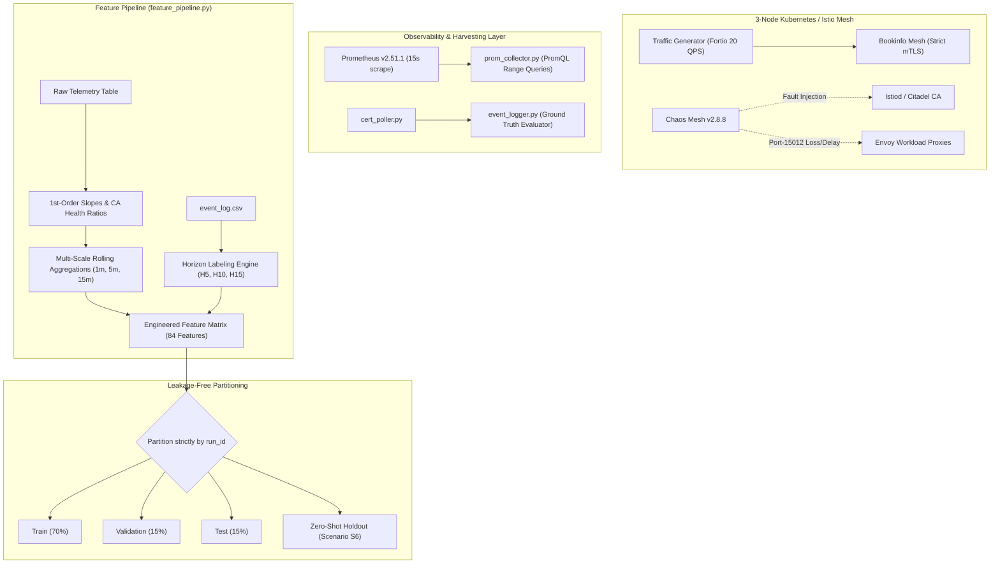

# Dataset Card: Istio mTLS Telemetry & Rotation Distress Dataset (v1)

## 1. Dataset Overview

- **Dataset Name**: `istio-mtls-telemetry-v1`
- **Domain**: Cloud-Native Service Mesh Security / Microservices Resilience / Automated Fault Prediction
- **Focus**: Early prediction (5, 10, 15-minute lead times) of mutual TLS (mTLS) certificate rotation stalls and expiration failures in Istio Service Mesh.
- **Data Modality**: Multivariate time-series telemetry (PromQL scraped gauges/rates, sidecar secret metadata, and kernel/socket fault injection indicators).
- **Temporal Resolution**: 15 seconds (aligned with Prometheus scrape step).
- **Total Features**: 84 engineered features (instantaneous rates, physical domain ratios, first-order velocity slopes, and multi-scale rolling aggregations: 1m, 5m, 15m).
- **Target Horizons**: Binary prediction indicators for $H \in \{5, 10, 15\}$ minutes lead time ($label\_H5, label\_H10, label\_H15$).

---

## 2. Dataset Architecture & Pipeline Flow

---

## 3. Data Schema & Feature Catalog (84 Features)

The dataset contains columns organized into 5 functional tiers plus metadata and labels:

### 3.1 Metadata & Partitioning (3 columns)
- `run_id` (str): Unique deterministic identifier for each experiment execution (e.g., `run_20261121_192500_s0_baseline`).
- `timestamp` (datetime / int): UTC ISO-8601 timestamp and epoch seconds (`timestamp_epoch`).
- `dataset_split` (str): Run-level partition assignment: `train`, `val`, `test`, or `holdout_test`.

### 3.2 Tier 1: Citadel CA Pipeline & CSR Dynamics (4 base + 8 derived)
- `csr_request_rate`: Instantaneous rate of workload CSR arrivals (`sum(rate(citadel_server_csr_count[1m]))`).
- `cert_issuance_rate`: Rate of successfully minted X.509 certs (`sum(rate(citadel_server_success_cert_issuance_count[1m]))`).
- `csr_auth_err_rate`: Citadel SPIFFE authentication failure rate (`sum(rate(citadel_server_authentication_failure_count[1m]))`).
- `csr_parse_err_rate`: ASN.1/CSR decoding error rate (`sum(rate(citadel_server_csr_parsing_err_count[1m]))`).
- `csr_success_ratio`: Dynamic CA throughput health $\frac{\text{cert\_issuance\_rate}}{\text{csr\_request\_rate} + \epsilon}$.
- `csr_request_rate_slope_15s`, `csr_request_rate_slope_1m`: First-order velocity derivatives capturing sudden CSR queue build-up.
- Rolling aggregates (`csr_request_rate_mean_{1m,5m,15m}`, `csr_request_rate_max_{1m,5m,15m}`, `csr_request_rate_std_{1m,5m,15m}`, and corresponding ratios).

### 3.3 Tier 2: Istiod Control-Plane Health & Resource Saturation (4 base + 12 derived)
- `istiod_process_cpu`: Istiod user/system CPU rate (`sum(rate(process_cpu_seconds_total{app="istiod"}[1m]))`).
- `istiod_memory_bytes`: Istiod Resident Set Size (RSS) in bytes (`sum(process_resident_memory_bytes{app="istiod"})`).
- `istiod_cgroup_cpu`: Cgroup container-level CPU consumption.
- `pilot_xds_pushes`: gRPC Envoy configuration push velocity (`sum(rate(pilot_xds_pushes[1m]))`).
- Velocity slopes: `istiod_process_cpu_slope_15s`, `istiod_process_cpu_slope_1m`, `istiod_memory_bytes_slope_15s`, `istiod_memory_bytes_slope_1m`.
- Rolling aggregates across windows $\{1\text{m}, 5\text{m}, 15\text{m}\}$: mean, max, and std deviation.

### 3.4 Tier 3: Sidecar Proxy Cryptographic State & Traffic Health (3 base + 10 derived)
- `envoy_cert_expiry_sec`: Minimum remaining cryptographic lifetime across mesh sidecars (`min(istio_agent_cert_expiry_seconds)`).
- `req_rate_total`: Mesh-wide request throughput (`sum(rate(istio_requests_total[1m]))`).
- `req_rate_5xx`: Mutual TLS handshake and upstream failure rate (`sum(rate(istio_requests_total{response_code=~"5.."}[1m]))`).
- `error_5xx_ratio`: Proportion of failing requests $\frac{\text{req\_rate\_5xx}}{\text{req\_rate\_total} + \epsilon}$.
- Velocity slopes and multi-window aggregates for certificate expiry degradation rate.

### 3.5 Tier 4: Cluster Topography & Node Churn (2 base)
- `pod_restarts_5m`: Kubernetes container restart count (`sum(increase(kube_pod_container_status_restarts_total[5m]))`).
- `node_ready_count`: Active ready worker nodes in cluster topology.

### 3.6 Tier 5: Target Labels & Evaluation Masks (4 columns)
- `label_H5` (int {0, 1}): Binary label indicating whether a hard expiration or critical rotation stall occurs within $(t, t + 300\text{s}]$.
- `label_H10` (int {0, 1}): Binary label indicating failure within $(t, t + 600\text{s}]$.
- `label_H15` (int {0, 1}): Binary label indicating failure within $(t, t + 900\text{s}]$.
- `already_failing` (int {0, 1}): Filter mask indicating that certificate lifetime is already expired ($t_{\text{expiry}} \le 0$) or mesh failure is already active. These rows are excluded during model training to avoid trivial post-failure bias.

---

## 4. Fault Scenarios & Data Generation Protocol

Telemetry is harvested across a suite of 10 targeted fault injection scenarios engineered with Chaos Mesh v2.8.8:

| Scenario ID | Name | Failure Mechanism | Telemetry Signature |
|:---|:---|:---|:---|
| **S0** | Baseline Traffic | Normal mesh operation (Fortio 20 QPS) | Stable expiry sawtooth, zero 5xx, CA ratio $\approx 1.0$ |
| **S1** | Istiod CPU Stress | 90% CPU load on control plane pod | CSR queue processing delay, XDS push latency |
| **S2** | Istiod Memory Stress| 256MB working set memory pressure | Slow GC cycles, Istiod container throttling |
| **S3** | Istiod Pod Kill | Sudden SIGKILL of active Istiod replica | Immediate gap in CA availability, gRPC reconnect storm |
| **S4** | Port 15012 Net Loss | 60% packet loss to Citadel mTLS port | Silent SDS timeout; cert ages past 50% without renewal |
| **S5** | CA Network Delay | 1000ms latency + 200ms jitter to CA | Handshake timeouts, gRPC retry exhaustion |
| **S6** | Container Clock Skew| +2h time jump inside workload pod | Synthetic zero-shot anomaly; immediate cert expiry trigger |
| **S7** | Worker Node Crash | Minikube worker reboot (`mtls-lab-m02`) | Mass pod relocation, burst CSR re-issuance |
| **S8** | CSR Scaling Storm | Cyclic deployment scaling (1 to 5 replicas) | CA queue spike, Citadel thread exhaustion |
| **S9** | Identity Disruption | ServiceAccount token invalidation | Token validation error spike (`csr_auth_err_rate > 0`) |
| **S10**| Compound Disaster | S1 CPU stress combined with S4 Net Loss | Rapid cascade into rotation stall and traffic drop |

---

## 5. Leakage Prevention Protocol

A major pitfall in time-series AIOps research is random row-level splitting. Because adjacent 15-second telemetry rows share overlapping rolling windows and autocorrelation, random shuffling leaks future information into training sets, artificially inflating validation accuracy to near-perfect levels.

To guarantee rigorous generalization:
1. **Run-Level Partitioning**: All telemetry points belonging to a specific `run_id` are placed exclusively in Train (70%), Validation (15%), or Test (15%).
2. **Held-Out Zero-Shot Scenario**: Scenario S6 (Clock Skew) is completely excluded from training and validation, reserved exclusively as a stress-test holdout for cross-scenario domain transfer evaluation.
3. **Feature-Level Safety**: The scenario identity (`scenario_id`) is strictly excluded from feature sets so models cannot memorize synthetic experiment markers.
4. **Already-Failing Masking**: Data points where the failure has already occurred are masked via `already_failing == 0` during model training.

---

## 6. Storage & File Formats

- **Primary Feature Matrix**: `data/processed/features_v1.parquet` (compressed Apache Parquet format preserving exact dtypes and columnar access).
- **Tabular Interoperability**: `data/processed/features_v1.csv` (CSV format for external spreadsheet and pandas inspection).
- **Raw Prometheus Range Data**: `data/raw/all_runs_metrics.parquet` (un-engineered raw PromQL metric series).
- **Ground-Truth Log**: `data/raw/event_log.csv` (formal transition log with timestamp, event type, and certificate remaining validity).
- **Execution Log**: `data/raw/experiment_log.csv` (deterministic audit trail of every fault injection run, seed, and timestamps).
